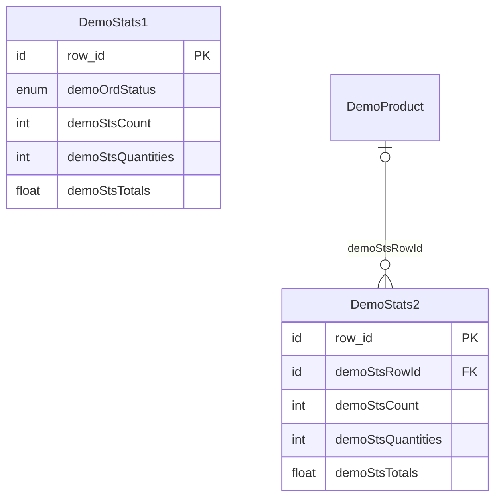

# User:designer

## General informations

**Name**:  Designer

**Preferred date format**: MM/DD/YYYY

**Preferred number format**: CD


# Module: DemoDashboard

**Depends on**: Demo

This module contains an example of a **custom ** component
for the demo **order management** application.

**Note**: The `Demo` module **must** be installed and configured
before importing this additional module.

## Relationships



## DemoStats1

```yaml
label: Statistics per statuses
table: select
```

Statistics per statuses

### Relationships

```yaml
belongs_to: []
has_many: []
```

### Fields

```yaml
required:
  demoOrdStatus: enum(30) using DEMO_ORD_STATUS list  # Order status [col:ord_status] [default:P]

optional:
  demoStsCount: int(10)  # [col:sts_count]
  demoStsQuantities: int(10)  # Ordered quantities [col:sts_quantities]
  demoStsTotals: float(10, 2)  # Ordered amount [col:sts_totals]

```

### Enumerations

```yaml
DEMO_ORD_STATUS:
  P: Pending status
  H: On hold
  V: Validated status
  D: Shipped status
  C: Canceled status
```

### State transitions (demoOrdStatus)

```yaml
P: [V, H, C]
V: [P, H, D, C]
H: [P, V, C]
C: [P, V]
D: []  # terminal
```

### Description (from code)

Statistics per statuses

### Hooks

```yaml
postLoad: ~
```

---

## DemoStats2

```yaml
label: Statistics per product
table: select
```

Stats per products

### Relationships

```yaml
belongs_to:
  - DemoProduct (demoStsRowId, optional)
has_many: []
```

### Fields

```yaml
optional:
  demoStsCount: int(10)  # [col:sts_count]
  demoStsQuantities: int(10)  # Ordered quantities [col:sts_quantities]
  demoStsTotals: float(10, 2)  # Ordered amount [col:sts_totals]

referenced:
  demoPrdReference: regexp(10)  # Product reference [col:prd_code]
  demoPrdName: char(100)  # Product name [col:prd_name]
  demoPrdType: enum(50) using DEMO_PRD_TYPE list  # Product type [col:prd_type]
  demoPrdAvailable: boolean  # Available product? [col:prd_available]
  demoPrdStock: int(11)  # Current stock for product [col:prd_stock]

```

### Actions

```yaml
DEMO_STS2_AVAILABLE:
DEMO_STS2_NOT_AVAILABLE:
```

### Description (from code)

Product statistics & availability monitoring

### Hooks

```yaml
available: Action: Make product available
notAvailable: Action: Make product not available
isActionEnable: ~
```

---

## External Objects

```yaml
widgets:
  DemoDashboard: Demo dashboard (using Google charts)
```

